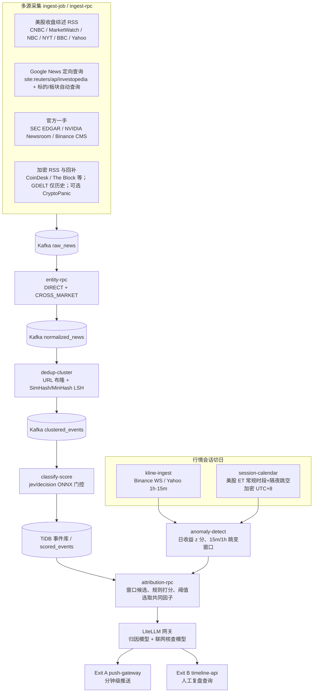

# 异动优先金融新闻事件系统：生产架构

本文描述 `/workspace/fin-news-events` Python MVP 已实现的能力，以及对应的生产级 Go / go-zero 服务划分。产品不做价格预测：价格涨跌只作为归因起点与事后展示，新闻影响分与候选排序不使用未来收益。

更完整的实测数据、时间线与对照表见同一 Page：[AI 金融新闻事件系统：异动优先归因与 Go/go-zero 架构实测](https://cursor.com/canvas/store-a2570073-d912-4e05-bcf0-9f6b2ef5bdfa/6576dd5b-a1a0-422b-9b63-5dc4f17858c8)。LiteLLM 接入变量见仓库根目录 `.env.example` 与 `configs/litellm_config.yaml`。

## 1. 异动优先主流程

主路径不是「先用新闻预测涨跌」，而是「先发现已发生的价格异动，再反查窗口内新闻」。



步骤说明：

1. **多源采集**：高优源 15–60 秒轮询（ETag/304）。美股收盘综述源包括 CNBC Top/Markets/Investing/Finance/Tech、MarketWatch Top Stories、NBC Business、NYT Business、BBC Business 与 Yahoo 标的 RSS。Google News 按异动标的与板块自动生成查询（如 `Nvidia shares`、`chip stocks`、`stock market today` + 日期，以及 `site:reuters.com` / `site:apnews.com` / `site:investopedia.com`）。官方一手包括 SEC EDGAR、NVIDIA Newsroom、Binance CMS。加密媒体 RSS 进入实时链。GDELT DOC 仅作历史回补（共享 IP 易 429）。可选 CryptoPanic 插件。
2. **清洗、去重、聚类**：两层实体映射后，Redis URL/标题去重与 48 小时滑动 LSH 聚类，写入事件库。
3. **jev 快速分类门控**：ONNX 三头（相关性门控、五大类、子类）毫秒级过滤噪声；命中或低置信样本再经 LiteLLM 标注模型抽取。事件入库，不在此步预测价格。
4. **行情会话切日**：美股按 `America/New_York` 常规时段（约 09:30–16:00 ET，自动兼容 EST/EDT）切日，涨跌含隔夜跳空（`ret_incl_gap`）；加密按 UTC+8 日历日。所有对外时间戳标注为 UTC+8。宏观对照包括 DXY、US10Y、US05Y。
5. **异动检测**：日收益与滚动 z 分，15 分钟 / 1 小时跳变窗口与放量确认。标的池：加密 BTC/ETH/SOL/XRP/BNB/DOGE/ADA；美股 NVDA、SMH、SOXX、QQQ、SPY、DIA、AAPL、MSFT、TSLA。
6. **窗口候选新闻**：加密取跳变前 6 小时至后 1 小时；美股取前 16 小时至后 9 小时，以覆盖盘前驱动。晚于跳变的新闻标记为「事后解释/报道」并降低时间权。
7. **规则打分**：`AttrScore = 0.30·时间贴近度 + 0.25·影响分 + 0.15·多源热度 + 0.15·方向一致性 + 0.15·标的相关性`，并计入权威度、独立来源数；与当日涨跌方向不一致的新闻降权或剔除；无市场关键词的政治报道、美股会话中的加密信贷类新闻降权。
8. **阈值选取共同因子**：候选原因按 `score >= 0.70` 或 `score >= top × 0.75` 选取，上限约 8 条，全部交给归因模型。多标的同向近窗先归并为 `equity_common` / `crypto_common`，必要时标注交叉溢出。
9. **LiteLLM 归因 + 联网核查**：只经 `LITELLM_BASE_URL/chat/completions`。核查标签为 `confirmed` / `single_source` / `unverified`。输出判定为 `ATTRIBUTED`、`NO_CLEAR_NEWS`、`CONTRARIAN`、`MIXED` 或 `EX_POST_REPORT`，并区分事前驱动与事后解释。逆势标的不得套用板块同向叙事。401/402/超时优雅降级，不中断流水线。

## 2. Go/go-zero 服务划分

生产沿用公司 Go + go-zero 栈（`goctl` 生成 `.api` / `.proto`，复用 `Breaker`、`PeriodLimit`、`AdaptiveShedder`）。

| 服务 | 通信与治理 | 对应 Python MVP | 职责 |
|---|---|---|---|
| ingest-job + ingest-rpc | CronJob + gRPC，ETag/304，熔断限流 | `sources/*`, `streaming.py` | 轮询综述 RSS、定向 Google News、SEC、新闻室、加密 RSS，写入 `raw_news` |
| entity-rpc | gRPC + Nacos 词表热加载 | `entity_mapper.py` | 别名 / CIK / 生态映射，标注 DIRECT 与 CROSS_MARKET |
| dedup-cluster | Kafka Consumer + Redis 锁 | `dedup_cluster.py` | URL 布隆、SimHash/MinHash LSH、48h 滑动聚类 |
| classify-score | Kafka Consumer + 内嵌 ONNX + LiteLLM | `classifier.py`, `fast_classifier.py`, `llm_clients.py` | jev 门控；命中后经 LiteLLM 标注模型；传导影响分写入事件库 |
| kline-ingest | Binance WS + Yahoo 定时补齐 | `market_data.py` | 写入 `kline_1m` / `kline_15m` / `kline_1h` |
| session-calendar | 配置化日历 | `hotlist.detect_sessions` | 美股 ET 会话（含跳空、DST）、加密 UTC+8 日界 |
| anomaly-detect | cron / 1–5 分钟任务 | `hotlist` 异动检测 | 日收益、z 分、跳变窗口，写 TiDB 与 Redis |
| attribution-rpc | 窗口触发 + LiteLLM 短调用 | `hotlist.score_candidates` 等 | 候选打分、共同因子、归因与核查 |
| push-gateway | Kafka → Webhook / gRPC Stream / WS | `streaming.py` | 分钟级推送异动与归因结果 |
| price-reaction | 定时对齐 | `market_data.py`, `evaluator.py` | +1h/+4h/+24h 异常收益，仅展示，不参与打分 |
| timeline-api | go-zero REST + Redis 缓存 | `exporter.py`, `outputs/attribution_*.md` | 复盘时间线与归因榜查询 |

## 3. Kafka Topic

| Topic | Partition Key | 幂等 | 消费组 |
|---|---|---|---|
| `raw_news` | `source_feed` | 生产者幂等；消费前 Redis `SETNX url_sha256` | `cg-entity-normalizer` |
| `normalized_news` | `primary_entity` | 按 `item_id` 去重 | `cg-dedup-cluster` |
| `clustered_events` | `cluster_id` | `cluster_version` 单调递增 | `cg-classify-score` |
| `scored_events` | `target_symbol` | `(event_id, target_symbol, stream_event_type)` | `cg-tidb-sink`，以及研究侧 `cg-price-reaction` |
| `kline_1m` / `kline_15m` / `kline_1h` | `symbol` | `(symbol, interval, open_time)` | `cg-session-calendar`, `cg-anomaly-detect` |
| `anomaly_windows` | `list_date` 或 `symbol` | `window_id` | `cg-attribution`, `cg-push-gateway` |
| `attribution_results` | `group_id` 或 `symbol` | `attr_id` | `cg-push-gateway`, `cg-tidb-sink` |
| `hotlist_updates` | `list_date` | 快照版本号 | `cg-timeline-cache` |
| `price_reactions` | `target_symbol` | `INSERT ... ON DUPLICATE KEY UPDATE` | `cg-eval-metrics` |

## 4. Redis 与 TiDB

### Redis

| Key | 用途 | TTL |
|---|---|---|
| `dedup:url:{sha256}` / `dedup:title:{norm}` | URL/标题去重 | 7 天 |
| `lsh:bucket:{band}:{hash}` / `cluster:vec:{id}` | LSH 聚类 | 48 小时 |
| `lock:cluster:{bucket}` | 聚类锁 | 5 秒 |
| `anomaly:{date}` | 当日异动 ZSET（score=\|z\|） | 36 小时 |
| `attr:board:{date}` / `attr:group:{date}` | 归因榜与共同因子快照 | 36 小时 |
| `cache:timeline:{symbol}` | 时间线热查询 | 30 秒 |

### TiDB（按月或按日 RANGE 分区）

除原有 `news_raw`、`events`、`event_assets`、`news_sources`、`price_reactions` 外，归因主链新增：

```sql
CREATE TABLE session_bars (
  symbol           VARCHAR(24) NOT NULL,
  market           VARCHAR(16) NOT NULL,  -- us | crypto
  session_date     DATE NOT NULL,         -- 美股为 ET 会话日，加密为 UTC+8 日
  open_ts          DATETIME(3) NOT NULL,
  close_ts         DATETIME(3) NOT NULL,
  prev_close       DECIMAL(18,6),
  open_px          DECIMAL(18,6),
  close_px         DECIMAL(18,6),
  ret_incl_gap     DECIMAL(12,6),
  gap_ret          DECIMAL(12,6),
  zscore           DECIMAL(8,3),
  PRIMARY KEY (symbol, session_date)
);

CREATE TABLE anomaly_windows (
  window_id        VARCHAR(40) PRIMARY KEY,
  list_date        DATE NOT NULL,
  market           VARCHAR(16) NOT NULL,
  symbol           VARCHAR(24) NOT NULL,
  asset_class      VARCHAR(16) NOT NULL,
  daily_ret_pct    DECIMAL(10,4),
  daily_z          DECIMAL(8,3),
  jump_start       DATETIME(3) NOT NULL,
  jump_end         DATETIME(3),
  peak_ret_z       DECIMAL(8,3),
  volume_z         DECIMAL(8,3),
  move_dir         VARCHAR(8),
  session_note     VARCHAR(256),
  KEY idx_date_z (list_date, market, daily_z)
) PARTITION BY RANGE COLUMNS(list_date) (
  PARTITION p202611 VALUES LESS THAN ('2026-12-01'),
  PARTITION pmax    VALUES LESS THAN (MAXVALUE)
);

CREATE TABLE attributions (
  attr_id                VARCHAR(40) PRIMARY KEY,
  window_id              VARCHAR(40),
  group_id               VARCHAR(64),
  market                 VARCHAR(16) NOT NULL,
  list_date              DATE NOT NULL,
  verdict                VARCHAR(24) NOT NULL, -- ATTRIBUTED / NO_CLEAR_NEWS / CONTRARIAN / MIXED / EX_POST_REPORT
  confidence             DECIMAL(5,4),
  attribution_zh         VARCHAR(1024) NOT NULL,
  timing                 VARCHAR(64),          -- 事前或同步 / 事后解释/报道
  verification_tier      VARCHAR(24),          -- confirmed / single_source / unverified
  independent_sources    INT,
  authority_score        DECIMAL(5,4),
  model                  VARCHAR(64),
  factcheck_status       VARCHAR(32),
  factcheck_model        VARCHAR(64),
  display_only_px        JSON,
  created_at             DATETIME(3) NOT NULL,
  KEY idx_date_market (list_date, market, group_id)
);
```

`price_reactions` 的 +1h/+4h/+24h 与异常收益字段仅供复盘展示，禁止回写到 `ImpactScore` 或 `AttrScore`。

## 5. Nacos 配置（命名空间 `fin-news-prod`）

Watch 热更新。密钥类配置走密钥管理系统，Nacos 只存引用。

| 配置项 | 示例 / 默认 | 说明 |
|---|---|---|
| 数据源轮询开关与间隔 | 官方源 15s，综述/Google 30–60s | GDELT 不进实时链 |
| `cluster.threshold` | `0.34` | 文本聚类阈值 |
| `jev.gate_threshold` | `0.40` | ONNX 门控 |
| `jev.fast_path_conf` | `0.72` | 高置信直通、跳过标注 LLM |
| `LITELLM_BASE_URL` | `http://litellm.internal/v1` | 唯一模型入口 |
| `LITELLM_API_KEY` | 密钥引用 | 网关虚拟键 |
| `LITELLM_MODEL_ATTRIBUTION` | `gemini-flash-lite` | 异动归因一句结论 |
| `LITELLM_MODEL_LABEL` | `gemini-flash-lite` | 事件抽取 / 蒸馏标注 |
| `LITELLM_MODEL_FACTCHECK` | `perplexity-sonar` | 联网多源核查 |
| `attribution.weights` | time 0.30, impact 0.25, heat 0.15, dir 0.15, rel 0.15 | 规则打分权重 |
| `attribution.cause_score_min` | `0.70` | 与 `cause_rel_of_top=0.75`、`cause_max_n=8` 一起做阈值选取 |
| `session.us_pre_hours` / `us_post_hours` | 16 / 9 | 美股候选窗 |
| `session.crypto_pre_hours` / `crypto_post_hours` | 6 / 1 | 加密候选窗 |
| Prompt 版本号 | `attr_v2` / `label_v1` / `factcheck_v1` | 与模型别名一起发布 |

接入公司 LiteLLM 通常只需改 `LITELLM_BASE_URL` 与 `LITELLM_API_KEY`。`OPENROUTER_API_KEY` 仅作 demo 回退，生产环境关闭。

## 6. 接口

### 分钟级推送（Exit A）

push-gateway 消费 `anomaly_windows` 与 `attribution_results`，向多智能体信号系统推送 `SignalEvent`（事件新建 / 多源升级）与 `AttributionUpdate`（异动归因）。风控侧应读取 `verification_tier`、`verdict` 与 `timing`：`unverified` 或仅事后解释的结果不得单独放大杠杆；`CONTRARIAN` 不得复用板块同向叙事。

建议 REST/gRPC：

- `GET /v1/attribution?date=YYYY-MM-DD&market=us|crypto|all&symbol=&tz=Asia/Kuala_Lumpur`
- `GET /v1/attribution/groups/{group_id}`
- `GET /v1/timeline?symbol=&start=&end=&layer=DIRECT|CROSS_MARKET`
- 推送：Webhook / gRPC Stream / WebSocket，主题 `attribution.updates`

查询返回异动榜、共同因子、候选原因（含独立源与权威度）、核查状态与花费；价格字段标记 `display_only`。

## 7. 打分与核验（与实现一致）

事件影响分（入库，不含价格）：

`ImpactScore = 100 · (0.35 B + 0.25 T + 0.20 C + 0.10 N + 0.10 M) · V`

其中 B 为子类基础量级，T 为跨市场传导权重，C 为来源可信度，N 为新颖度/热度，M 为方向置信，V 为核验折价（官方或多源为 1.00，单一一线 0.88，未核实 0.68）。

归因分见第 1 节公式。核验分层：`confirmed`（官方/SEC 或至少两个独立权威源）、`single_source`、`unverified`。时效：事前或同步 vs 事后解释/报道。

## 8. Demo 与生产对应

| 能力 | Python Demo | 生产 Go/go-zero |
|---|---|---|
| 多源采集（综述 RSS、定向查询、SEC、加密 RSS） | `sources/*`, `market_rss.py`, `google_news.py` | ingest-job + ingest-rpc |
| 实体映射 | `entity_mapper.py` | entity-rpc + Nacos 词表 |
| 去重聚类 | `dedup_cluster.py` | dedup-cluster + Redis |
| 快速分类与事件库 | `fast_classifier.py`, `pipeline.py` | classify-score + TiDB `events` |
| 会话切日与 K 线 | `hotlist.detect_sessions`, `market_data.py` | kline-ingest + session-calendar |
| 异动检测 | `hotlist` 日收益/z/跳变窗 | anomaly-detect |
| 归因打分、共同因子、逆势 | `score_candidates`, `aggregate_candidate_causes`, `annotate_contrarian` | attribution-rpc |
| 全部模型调用 | `llm_clients.LiteLLMClient` | 同一 LiteLLM 网关与 Nacos 别名 |
| 分钟级推送 | `streaming.py` `--poll` | push-gateway |
| 人工复盘 | `outputs/attribution_*.md`, `exporter.py` | timeline-api |
| 配置 | `.env` / `.env.example` | Nacos + 密钥系统 |

## 9. 落地路线（相对当前 MVP）

1. **Shadow 接入与归档**：用 goctl 落地 ingest、entity、dedup 与 kline-ingest，原始新闻持续写入 TiDB，补齐媒体 RSS 无历史分页的缺口。
2. **分类与网关（MVP 已完成，待迁 Go）**：教师标注与 jev 蒸馏已完成；全部模型调用已统一到 LiteLLM。生产只需配置网关地址、密钥与模型别名。
3. **会话切日与归因服务（MVP 已完成，待迁 Go）**：ET 会话、综述源、阈值选取、方向过滤与 CONTRARIAN 已在 `run.py --hotlist --market us` 验证。生产实现 anomaly-detect 与 attribution-rpc，并对外提供查询/推送接口。
4. **多智能体标定**：将归因结果接入多空辩论与风控；对 `unverified`、纯事后解释自动限制仓位。
